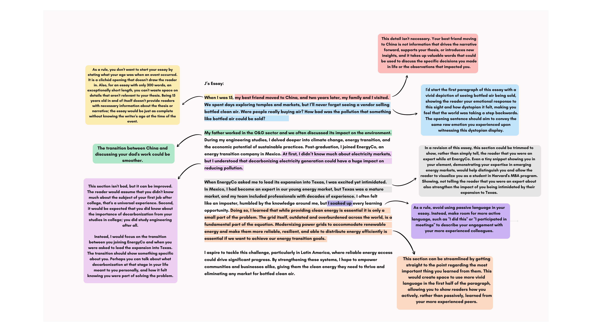

# J's Essay

**Collection:** Successful Harvard Business School Essays (2025)  
**Source:** <https://business.thecrimson.com/successful-harvard-business-school-application-essays-2025>  
**Essay #:** 2

## Prompt

Business-Minded Essay Prompt: "Please reflect on how your experiences have influenced your career choices and aspirations and the impact you strive to make on the businesses, organizations, and communities you plan to serve."

## Essay

When I was 15, my best friend moved to China, and two years later, my family and I visited. We spent days exploring temples and markets, but I’ll never forget seeing a vendor selling bottled clean air. Were people really buying air? How bad was the pollution that something like bottled air could be sold?

My father worked in the O&G sector and we often discussed its impact on the environment. During my engineering studies, I delved deeper into climate change, energy transition, and the economic potential of sustainable practices. Post-graduation, I joined EnergyCo, an energy transition company in Mexico. At first, I didn’t know much about electricity markets, but I understood that decarbonizing electricity generation could have a huge impact on reducing pollution.

When EnergyCo asked me to lead its expansion into Texas, I was excited yet intimidated. In Mexico, I had become an expert in our young energy market, but Texas was a mature market, and my team included professionals with decades of experience. I often felt like an imposter, humbled by the knowledge around me, but I soaked up every learning opportunity. Doing so, I learned that while providing clean energy is essential it is only a small part of the problem. The grid itself, outdated and overburdened across the world, is a fundamental part of the equation.

Modernizing power grids to accommodate renewable energy and make them more reliable, resilient, and able to distribute energy efficiently is essential if we want to achieve our energy transition goals.

I aspire to tackle this challenge, particularly in Latin America, where reliable energy access could drive significant progress. By strengthening these systems, I hope to empower communities and businesses alike, giving them the clean energy they need to thrive and eliminating any market for bottled clean air.

## Professional Review by Cosmic College Consulting

This essay succeeds because it establishes a clear, personal motivation for J’s interest in clean energy, demonstrates the depth of that motivation through vivid storytelling and real-world experience, and shows how J will be an excellent MBA student. J’s memory of seeing bottled “clean” air sold in China is a striking, visceral, dystopian image that hooks the reader instantly. The connection to childhood conversations about the environmental effects of their father’s oil and gas career deepens this motivation by introducing nuance into their origin story.

Equally compelling is how J connects their academic and professional experience to their motivation. Their work expanding an energy transition company into Texas shows initiative, humility, and growth, traits every MBA program wants from their students. By sharing how they learned from industry veterans and discovered the crucial role of power grids, J demonstrates their intellectual readiness to benefit from Harvard’s community of experts and peers. Most importantly, the essay closes with a tangible, inspiring goal, abolishing the need for bottled clean air, and explains a step J will take in accomplishing that by modernizing grids and expanding access to sustainable energy in Latin America. This vision makes it easy for admissions officers to root for J’s success and see the broader impact of investing in their education.

Prospective MBA applicants should study how this essay weaves story, credibility, learning, and ambition into a single, compelling narrative. Scroll below to see a critical review of J’s essay by a Cosmic College Consulting MBA admissions expert:

## Critical Review

Annotated feedback from Cosmic College Consulting:

---

[← Back to menu](../README.md)
